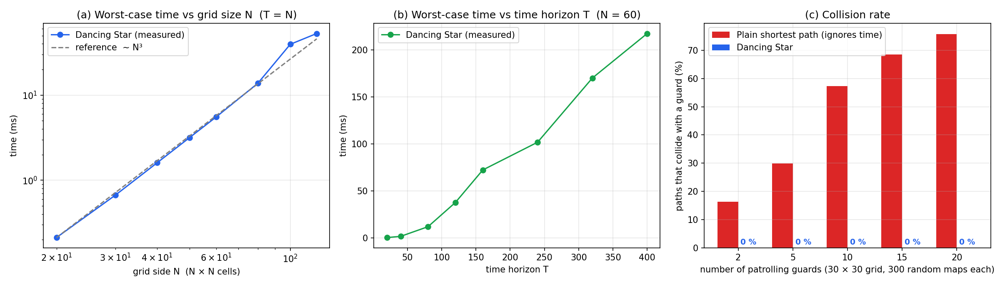
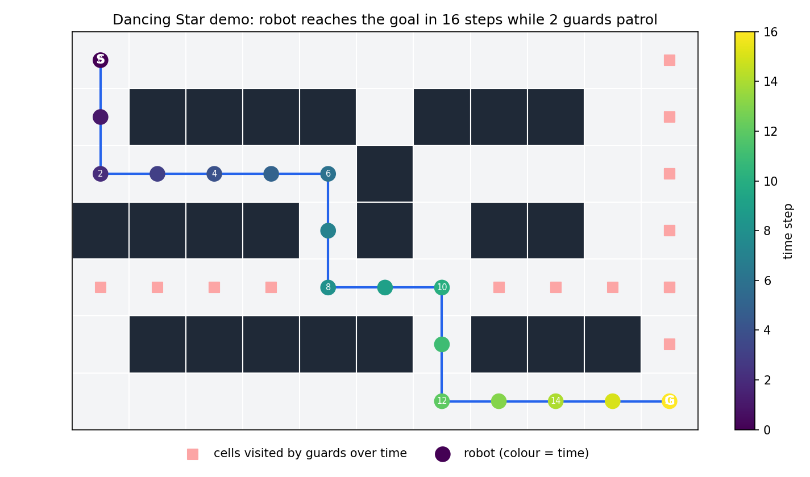

# Delta Star Algorithm

Delta Star Algorithm: a C++ path planner that finds the fastest route for a robot without hitting moving obstacles

It finds the fastest safe path for a robot on a grid when other things on the grid are moving. It's A\* with one extra idea: the state is `(x, y, t)`, so time is part of it. That lets the robot wait when waiting is the best move.

The math is in [MATH.md](MATH.md). A contest-style problem built on this is in [PROBLEM.md](PROBLEM.md).



**Credit:** searching over `(x, y, time)` isn't new. People call it Space-Time A\*. This repo is my own C++ version of it, with a fast move check, tests, benchmarks and a contest problem. I wrote it in C++ and checked it against a slow brute-force solver, so I know the answers are right.

## The problem

A robot starts on cell `S` and wants to reach cell `G` as fast as it can. Guards walk back and forth on routes we already know. The robot must never stand on a guard's cell, and it can't swap places with a guard. It's allowed to stand still for a step.

Written formally: we have a grid with walls, a start `S`, a goal `G`, and `K` guards. We know where guard `i` is at every time `t ≤ T`, and that's `g_i(t)`. We want the smallest `t` and a list of cells `v_0 = S, v_1, ..., v_t = G`. Each step is a move to a neighbouring cell or a wait. No `v_s` can be occupied by a guard at time `s`, and the robot never swaps places with a guard.

A normal shortest-path search (BFS, Dijkstra, plain A\*) assumes the map never changes. That doesn't hold here. A cell that's free now can be blocked one step later, and sometimes the best plan is just to wait until the way is clear.

Where you could use it:

* warehouse robots that share aisles with forklifts and workers on a schedule
* stealth games where guards patrol fixed routes
* drones or rovers crossing an area while scheduled vehicles pass through
* puzzles like the one in [PROBLEM.md](PROBLEM.md)

## Why a plain shortest path fails

A plain shortest path only looks at walls, so it walks straight into patrolling guards. I tried it on random 30 × 30 maps, and here's what I saw. It hit a guard in 16 % of the maps with 2 guards, and in 76 % of the maps with 20 guards. Dancing Star never hit one. It solved about 1 380 of the 1 399 maps and had 0 collisions in all of them. In the rest, no safe path existed within the time limit.

## How it works

1. The state is `(x, y, t)`.
2. A move is up, down, left, right, or wait. Each one takes 1 time step.
3. A move is allowed if the next cell isn't a wall, no guard is on it at time `t+1`, and the robot isn't swapping places with a guard.
4. I work out where every guard is at every time before the search starts and keep it in a table. That makes each check `O(1)`.
5. The estimate is the Manhattan distance to the goal. It never overestimates, so when the goal first comes off the heap, that's the best answer. There's nothing faster.



## Complexity

`W × H` is the grid, `T` is the number of time steps and `K` is the number of guards.

| Part | Time | Memory |
|---|---|---|
| Build the guard table | `O(T × K)` | `O(W × H × T)` |
| Search (worst case) | `O(W × H × T × log(W × H × T))` | `O(W × H × T)` |
| One move check | `O(1)` | - |

My first version checked every guard on every move, which cost `O(K)` per move. I didn't like that, so I added the table.

For the worst case I made the goal unreachable. The search can't stop early, so it has to look at every state:

| Grid N × N | T | States expanded | Time |
|---|---|---|---|
| 20 × 20 | 20 | 1 746 | 0.2 ms |
| 60 × 60 | 60 | 39 558 | 5.5 ms |
| 100 × 100 | 100 | 176 493 | 39 ms |
| 120 × 120 | 120 | 301 927 | 53 ms |

If the start is in a corner, there are at most $\binom{T+3}{3}$ states (the proof is in [MATH.md](MATH.md)). In graph (a), the time grows like `N³` when `T = N`. In graph (b), the grid is fixed and the time grows roughly in a straight line with `T`. The numbers come from [`benchmarks/results.csv`](benchmarks/results.csv). Your machine won't give the same times, so don't expect exact matches.

## Limits and assumptions

What the algorithm assumes:

* Time moves in whole steps. A move and a wait both cost 1.
* Moves are up, down, left and right only. No diagonals, because the Manhattan estimate needs that.
* The guard routes are fixed and known before we start. If obstacles move in ways we can't predict, you'll have to plan again every few steps.
* Every route cell is inside the grid and isn't a wall, and neighbouring route cells touch. The code throws an error for an empty route or a cell outside the grid.
* Guards don't react to the robot. Two guards can stand on the same cell.
* The start cell must be free at `t = 0`.
* "Not found" means the goal can't be reached within `T` steps. It doesn't mean it can never be reached.

Limits in the code:

| Limit | Value |
|---|---|
| Guards | at most **32** (one bit per guard in a `uint32_t`) |
| Memory | about **9 bytes × W × H × (T + 1)** |
| Time steps | you pick `T`. Time and memory grow in a straight line with it. |

Worst cases I measured (goal unreachable, 20 guards):

| Grid | T | States expanded | Time | Peak memory |
|---|---|---|---|---|
| 50 × 50 | 200 | 375 748 | 0.05 s | ~11 MB |
| 100 × 100 | 500 | 4 009 148 | 0.81 s | ~47 MB |
| 100 × 100 | 1000 | 8 997 648 | 1.75 s | ~90 MB |

The contest problem in [PROBLEM.md](PROBLEM.md) has `n, m ≤ 30`, `k ≤ 10`, `T ≤ 500` and route length `L ≤ 30`. Its worst case ran in about 0.07 s and 11 MB, so the 1 second / 256 MB limits are very safe.

## What's in the repo

```
DeltaStar/
├── README.md
├── PROBLEM.md          # the contest-style problem
├── MATH.md             # formulas, proof, complexity
├── LICENSE
├── run_tests.sh        # compiles and checks the samples
├── src/
│   ├── dancingstar.hpp # the algorithm (header only)
│   └── demo.cpp        # prints a solved map step by step
├── solution/
│   └── solve.cpp       # solution for PROBLEM.md
├── examples/           # sample1..3 .in / .out
├── benchmarks/
│   ├── bench.cpp       # speed and collision tests
│   ├── plot.py         # draws the two graphs in docs/
│   ├── verify.py       # a slow brute-force checker
│   └── results.csv
└── docs/
    ├── benchmark.png
    └── demo_path.png
```

## Quick start

```bash
g++ -std=c++17 -O2 src/demo.cpp -o demo && ./demo        # watch the robot move
g++ -std=c++17 -O2 solution/solve.cpp -o solve && ./solve < examples/sample2.in   # prints 13
./run_tests.sh                                           # samples + checker
g++ -std=c++17 -O2 benchmarks/bench.cpp -o bench && ./bench > benchmarks/results.csv
python3 benchmarks/plot.py                               # you'll need matplotlib
```

## Using it in your own code

```cpp
#include "src/dancingstar.hpp"
using namespace dancing;

Guard g;  g.route = {{0,4}, {1,4}, {2,4}};          // walks back and forth
DancingStar planner(grid, {g}, /*maxT=*/100);       // grid: vector<string>, '#' = wall
auto r = planner.solve({0,0}, {9,9});               // start, goal as {x, y}
if (r.found) std::cout << r.steps << "\n";          // r.path[t] = robot position at time t
```

## Testing

* The samples are in `examples/`.
* `benchmarks/verify.py` is a separate brute-force solver that I wrote. I ran it against the C++ code on 300 random small maps, and they never disagreed.

## Things you could try

* Make waiting cost more, so the robot doesn't just sit there.
* Add a penalty for cells next to a guard.
* Let guards move randomly and plan again every few steps.
* Plan for several robots at once. That's a harder problem, but it's the natural next step.

## License

MIT. See `LICENSE`.
